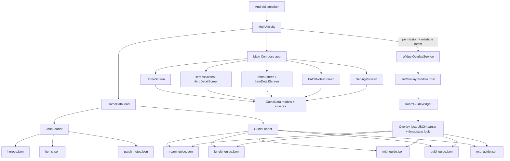
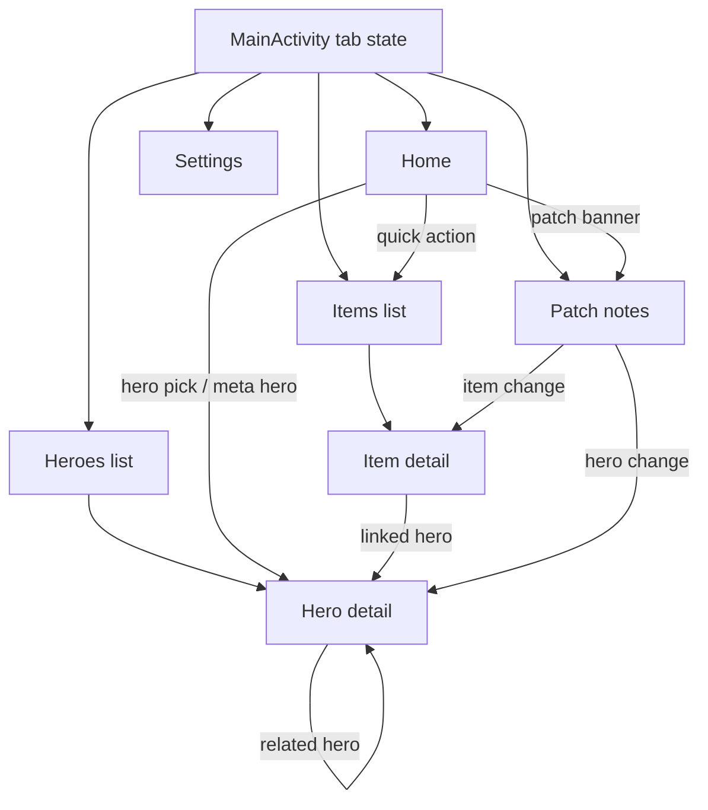
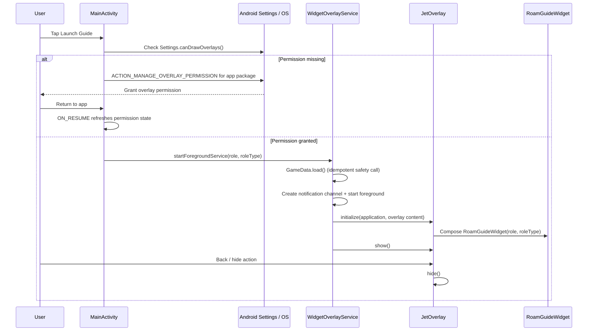

# MLBB Plus — Project Structure and Dependency Map

> **Scope:** This document describes the project as it exists in this repository snapshot (21 November 2026 / data patch 2.2.23). It is an implementation map, not a proposed architecture. Planned or absent components are called out explicitly.

## 1. System at a glance

MLBB Plus is a single-module Android application. Its launcher experience is built with Jetpack Compose. Bundled JSON files provide hero, item, patch-note, and five-lane guide content. A foreground service owns the separate always-on-top Compose overlay.



The screen-side guide parser and overlay-side guide parser are separate implementations. They read the same guide assets for different purposes: screen summaries versus the live, time-sensitive overlay plan.

## 2. Repository tree

```text
MLBB-Plus/
├── app/
│   ├── build.gradle.kts
│   ├── proguard-rules.pro
│   └── src/main/
│       ├── AndroidManifest.xml
│       ├── assets/
│       │   ├── heroes.json
│       │   ├── items.json
│       │   ├── patch_notes.json
│       │   ├── roam_guide.json
│       │   ├── jungle_guide.json
│       │   ├── mid_guide.json
│       │   ├── gold_guide.json
│       │   ├── exp_guide.json
│       │   └── heroes/*.webp
│       ├── java/com/mlbb/plus/ui/
│       │   ├── MainActivity.kt
│       │   ├── WidgetOverlayService.kt
│       │   ├── components/UiKit.kt
│       │   ├── model/Models.kt
│       │   ├── model/Guides.kt
│       │   ├── screens/
│       │   │   ├── AssetImage.kt
│       │   │   ├── HomeScreen.kt
│       │   │   ├── HeroesScreen.kt
│       │   │   ├── ItemsScreen.kt
│       │   │   ├── PatchNotesScreen.kt
│       │   │   └── SettingsScreen.kt
│       │   ├── theme/MLBBPlusTheme.kt
│       │   └── widgets/
│       │       ├── JetOverlay.kt
│       │       └── OverlayWidgets.kt
│       └── res/
│           ├── drawable/
│           ├── mipmap-anydpi-v26/
│           └── values/{colors.xml,strings.xml,themes.xml}
├── docs/
│   ├── overview.md
│   ├── structure.md
│   ├── links.md
│   ├── MATCHUP-DATA-SOURCES.md
│   ├── MATCHUP-DATA-UPDATE.md
│   ├── UX-UI-OVERHAUL.md
│   └── matchup-data-audit.json
├── gradle/
│   ├── libs.versions.toml
│   └── wrapper/{gradle-wrapper.jar,gradle-wrapper.properties}
├── build.gradle.kts
├── settings.gradle.kts
├── gradle.properties
├── gradlew
├── gradlew.bat
└── readme.md
```

`app/src/main/assets/heroes/` contains the bundled hero portrait WebP files. The project snapshot has 133 hero records and 41 item records in the JSON data. The resource directory contains launcher artwork and Android theme resources.

## 3. Startup and navigation chain

### 3.1 Process and data startup

1. Android launches `MainActivity` from the `MAIN` / `LAUNCHER` intent filter in `AndroidManifest.xml`.
2. `MainActivity.onCreate()` calls `GameData.load(this)` before Compose content is installed.
3. `GameData.load()` is synchronized and idempotent (`isLoaded` prevents a second load).
4. `JsonLoader` parses `heroes.json`, `items.json`, and `patch_notes.json` into Kotlin model objects.
5. Hero core-build item names are reconciled with the parsed item catalogue by item ID.
6. `GuideLoader.loadAll()` parses the five guide JSON assets and links guide hero picks to `Hero.id` using case-insensitive hero-name matching.
7. `GameData` builds lookup/index maps for hero IDs, item IDs, guide references, and heroes grouped by core item.
8. `MLBBPlusApp` renders the main navigation and selected screen from this in-memory data.

`GameData` is the current in-process single source of truth for loaded catalogue data. There is no Room database, remote API client, repository interface, dependency-injection graph, or ViewModel layer in this snapshot. JSON is bundled locally, so core catalogue browsing does not require a network connection.

### 3.2 Main screen navigation

`MainActivity.kt` owns the root Compose navigation state:

- `Tab`: `HOME`, `HEROES`, `ITEMS`, `PATCH`, `SETTINGS`.
- Selected role and guide-type ID.
- Selected hero / item detail records and the return tab for hero details.
- Overlay permission and running state.
- The `auto_start_last_role` preference and saved last role/type (`SharedPreferences`).
- Back handling and saveable state for section roots.

On compact windows, the app uses a Material 3 `NavigationBar`. At widths of at least 600 dp, it uses `NavigationRail`. This is manual adaptive branching in `MainActivity`; the project does not currently use Navigation Compose or Navigation 3.



### 3.3 Screen-by-screen connections

| Screen / composable | Main inputs | Navigation or output |
|---|---|---|
| `HomeScreen` | Selected role/type, overlay permission/running state, `GameData` | Changes role/type; launches overlay; opens hero, item, or patch details |
| `HeroesScreen` | `GameData.heroes`, hero click callback | Opens `HeroDetailScreen` |
| `HeroDetailScreen` | Selected `Hero`, `GameData` ID maps and guide references | Overview / relationship content; related hero and item links |
| `ItemsScreen` | `GameData.items` | Opens `ItemDetailScreen` |
| `ItemDetailScreen` | Selected `Item`, item/hero indexes | Opens related items or heroes |
| `PatchNotesScreen` | `GameData.patchNotes`, hero/item lookup maps | Opens changed hero or item details |
| `SettingsScreen` | Overlay permission and auto-start preference, loaded data health | Requests Android overlay settings; changes auto-start preference; displays asset diagnostics |

`components/UiKit.kt` supplies shared visual controls (headers, labels, filter pills, search, sorting, tier badges, role colors, and icon definitions). Screen-specific layout and detail content remain in their respective screen files.

## 4. Data model and asset relationships

### 4.1 Hero catalogue: `heroes.json` → `Models.kt` → hero UI

- Root metadata describes version, update date, patch, season, source, patch changes, equipment changes, schema notes, and matchup dataset provenance.
- `heroes[]` contains hero identity, roles/lanes, tier/difficulty, rates, skills, emblems, core builds, matchup IDs, descriptions/lore, tags, images, and patch notes.
- `JsonLoader.loadHeroes()` converts each record into `Hero`, `HeroSkill`, `EmblemInfo`, `HeroStats`, and `BuildItem` values.
- Relationship arrays (`counters`, `counteredBy`, `synergies`, `bestPartners`) contain hero IDs; the UI resolves those IDs through `GameData.heroesById`.
- `HeroImage()` in `AssetImage.kt` resolves JSON image paths / hero slugs to bundled portrait assets and renders a fallback when an image is unavailable.
- `HeroesScreen.kt` contains the searchable/filterable hero list, hero cards, hero detail tabs, overview, and hero relationship panels.

### 4.2 Item catalogue: `items.json` → `Models.kt` → item UI

- Root metadata describes the patch and item catalogue.
- `items[]` contains item ID/name, category, tier, price, stats, passive/active descriptions, build paths, relationship IDs, recommendations, tags, and image path.
- `JsonLoader.loadItems()` creates `Item` and `ItemStat` values.
- `ItemImage()` resolves the image path and provides a fallback.
- `GameData` builds `itemsById` and `heroesByCoreItem` indexes.
- `ItemsScreen.kt` renders item search/filter/sort, item detail, item relations, and links to heroes using the item.

### 4.3 Patch notes: `patch_notes.json` + hero manifest → `PatchData`

- `JsonLoader.loadPatchNotes()` reads the flat patch-note root or nested `originalServer` / `advancedServer` form.
- It parses hero and item changes, highlights, battlefield/system changes, warnings, and metadata.
- It then reads `heroes.json.patchChanges` and merges those hero entries into the Original Server hero-change list by hero ID. `heroes.json.equipmentPatchChanges` is also copied into `PatchData.equipmentChanges`.
- `HomeScreen.kt` uses patch information for the home banner and patch movers; hero/item screens use patch badges/detail context; `PatchNotesScreen.kt` presents the full patch view.

### 4.4 Role guides: five JSON files → `GuideLoader` → Home and overlay

The guide files are:

| Asset | Role | Guide types in this snapshot |
|---|---|---:|
| `roam_guide.json` | Roam | 6 |
| `jungle_guide.json` | Jungle | 5 |
| `mid_guide.json` | Mid | 5 |
| `gold_guide.json` | Gold | 5 |
| `exp_guide.json` | EXP | 5 |

Each asset uses a root structure with `meta`, role-specific auxiliary data (such as blessings, retribution types, or emblem guide), `roles[]`, `changelog`, `objectives`, and `battle_spells`. A guide type contains an ID/label/playstyle, hero picks, spells, emblem, core items, strengths/weaknesses, win/lose conditions, timed `steps[]`, and optional objective templates.

**Screen-side path:** `GuideLoader.loadAll(context, heroes)` reads each role asset. It parses metadata, mechanics, global rules, buffs/emblems, spell defaults, guide types, hero picks, and core item names into `GuideFile` / `GuideType` / `HeroPick` models. Hero picks are linked to hero IDs by name. `HomeScreen.kt` uses these to render role/type briefings and quick picks. `GameData` builds `guideRefsForHero()` and `guideRefsForItem()` indexes so hero/item detail screens can show guide usage.

**Overlay-side path:** `WidgetOverlayService` hosts `RoamGuideWidget` in `JetOverlay`. `OverlayWidgets.kt` has its own private parser (`loadGuide`, `parsePlan`, `parseStep`, timer parsing) because the overlay needs timed step and objective state. It selects `${role.lowercase()}_guide.json`, computes game-time/objective state, and renders the interactive guide. Despite the historical function name `RoamGuideWidget`, it receives the selected role and role type and is the shared overlay entry point for the five role assets.

### 4.5 Images and Android resources

- `app/src/main/assets/heroes/*.webp`: bundled hero portraits consumed by `HeroImage()`.
- `app/src/main/res/drawable/`: launcher foreground/background vector artwork.
- `app/src/main/res/mipmap-anydpi-v26/`: adaptive launcher icon definitions.
- `app/src/main/res/values/colors.xml`: Android resource color tokens.
- `strings.xml`: app and notification strings.
- `themes.xml`: platform window theme and system-bar defaults.
- `MLBBPlusTheme.kt`: Compose theme definitions. `AppUiTheme` / `AppUiColors` are for the main app; `MLBBPlusTheme` / `MLBBPlusColors` are used by the floating overlay. Keep these roles distinct when changing UI styling.

## 5. Overlay launch and lifecycle chain



`AndroidManifest.xml` declares `SYSTEM_ALERT_WINDOW`, `FOREGROUND_SERVICE`, `FOREGROUND_SERVICE_SPECIAL_USE`, and `POST_NOTIFICATIONS`. The service is non-exported and declared with foreground type `specialUse` plus a subtype explanation. `WidgetOverlayService` creates an ongoing notification with an app-open intent and Stop action, updates the active role/type, initializes the overlay once per service instance, and hides/stops the overlay on destruction.

`JetOverlay.kt` is the low-level window host. It owns the overlay window, ComposeView attachment, and lifecycle / saved-state / ViewModel-store owners needed by Compose outside an Activity. `OverlayWidgets.kt` owns the visible guide, overlay-specific parsing, interaction state, game timer, objective timers, and enemy spell tracker UI.

## 6. Kotlin file responsibilities

| File | Responsibility | Main dependencies / consumers |
|---|---|---|
| `MainActivity.kt` | Activity entry point, root navigation, settings/preferences, permission flow, service launch | `GameData`, all screens, `WidgetOverlayService`, `AppUiTheme` |
| `WidgetOverlayService.kt` | Foreground service lifecycle, notification, active role/type, overlay initialization/show/hide | `GameData`, `JetOverlay`, `RoamGuideWidget`, `MLBBPlusTheme` |
| `components/UiKit.kt` | Shared app composables, icons, role/tier colors, search/filter/sort primitives | Main screens |
| `model/Models.kt` | Hero/item/patch models, JSON parsers, `JsonLoader`, `GameData` and cross-reference indexes | Activity, screens, settings diagnostics, overlay service |
| `model/Guides.kt` | Guide screen models, guide asset parser, hero/item guide reference models | `GameData`, Home and detail screens |
| `screens/HomeScreen.kt` | Home dashboard, role/type picker, guide summary, patch/meta/quick actions, launch CTA | `GameData`, guide models, shared components, images |
| `screens/HeroesScreen.kt` | Hero catalogue, filters/search/sort, hero detail and relationship tabs | `Hero`, `GameData`, `HeroImage`, `ItemImage` |
| `screens/ItemsScreen.kt` | Item catalogue, filters/search/sort, item detail and related entities | `Item`, `GameData`, `ItemImage`, `HeroImage` |
| `screens/PatchNotesScreen.kt` | Patch note sections/cards and navigation to changed entities | `PatchData`, `GameData` |
| `screens/SettingsScreen.kt` | Overlay permission request UI, auto-start setting, data-file status/diagnostics | Activity callbacks, `GameData` |
| `screens/AssetImage.kt` | Coil asset model resolution, hero/item portrait rendering and fallbacks | Bundled image assets, `Hero`, `Item` |
| `theme/MLBBPlusTheme.kt` | Separate Compose color schemes / typography for app and overlay | Main app and overlay service |
| `widgets/JetOverlay.kt` | WindowManager overlay host and Compose lifecycle owners | `WidgetOverlayService`, Compose and lifecycle APIs |
| `widgets/OverlayWidgets.kt` | Shared role guide overlay UI, local JSON parser, timers and spell tracker | Role guide JSON, `GameData`, overlay theme |

## 7. Build, platform, and dependencies

- Gradle root project: `MLBB Assistant 2.0`; included module: `:app`.
- Android Gradle Plugin: `9.2.1`.
- Kotlin: `2.3.21`; Kotlin Compose compiler plugin is applied through the version catalog.
- Compile SDK: `37`; target SDK: `36`; minimum SDK: `29`.
- Java source/target compatibility: `17`.
- Compose BOM: `2026.06.00`.
- AndroidX Core KTX: `1.16.0`.
- Lifecycle: `2.11.0`.
- Activity Compose: `1.13.0`.
- Coil Compose: `3.0.4`.
- SavedState: `1.2.1`.
- Other UI: Compose UI, Foundation, Material 3, tooling preview.
- Repositories: Google, Maven Central, JitPack.
- Release build enables code minification and resource shrinking; debug disables both.
- Gradle wrapper distribution: Gradle `9.6.1`.

The versions above are read from `gradle/libs.versions.toml`, `app/build.gradle.kts`, and `gradle/wrapper/gradle-wrapper.properties`; they are not recommendations to upgrade blindly.

## 8. Change-impact guide

| If you change… | Also inspect / validate… |
|---|---|
| Hero JSON fields | `Hero`, `JsonLoader.loadHeroes`, hero list/detail UI, `matchup-data-audit.json` |
| Hero IDs or names | Item/guide references, guide name-to-ID linking, relationship IDs, patch changes |
| Item JSON fields | `Item`, `JsonLoader.loadItems`, item detail UI, hero core-build resolution |
| Guide JSON schema | Both `GuideLoader` and the private parser in `OverlayWidgets.kt`; Home and overlay must remain compatible |
| Objective or spell timing | Guide `meta`, `battle_spells`, overlay timer parsing/computation, in-game behavior checks |
| Patch schema | `JsonLoader.loadPatchNotes`, hero manifest merge, Home banner, Patch screen, entity badges |
| Main app theme | `AppUiTheme` / `AppUiColors`, app screens, system bars |
| Overlay appearance | `MLBBPlusTheme` / `MLBBPlusColors`, `OverlayWidgets.kt` (overlay-only) |
| Overlay lifecycle / permission | Manifest, `MainActivity`, `WidgetOverlayService`, `JetOverlay`, Android version behavior |
| Gradle dependency/version | Version catalog, app plugin configuration, wrapper compatibility, clean debug and release builds |

## 9. Current architectural boundaries and known maintenance risks

1. **No repository abstraction yet.** `GameData` is a process-wide singleton that loads bundled assets directly. This is adequate for the current offline/static data model but will need a repository/data-source boundary for remote refresh, caching, or tests.
2. **Two guide parsers.** `GuideLoader` and `OverlayWidgets.kt` parse the same guide files independently. Schema changes must be checked against both; a future shared parser/model layer would reduce drift.
3. **Root navigation is hand-managed.** Navigation state lives in `MainActivity` rather than Navigation Compose / Navigation 3. Preserve Back and cross-screen return behavior when modifying it.
4. **Preferences use SharedPreferences directly.** The current saved values are last role, last guide type, and auto-start-last-role. DataStore would be a reasonable future migration if settings grow.
5. **Bundled content is static until the app is updated.** There is no in-app data downloader or background content refresh in this snapshot.
6. **Tests are not present in this repository snapshot.** Add parser tests, schema/ID integrity tests, and service/permission behavior tests before expanding the data/update pipeline.
7. **Build verification is environment-dependent.** A full build requires the configured Android SDK and successful dependency / Gradle distribution resolution.

## 10. Documentation cross-links

- Product mission and roadmap: [overview.md](overview.md)
- External references and sources: [links.md](links.md)
- Matchup data methodology: [MATCHUP-DATA-SOURCES.md](MATCHUP-DATA-SOURCES.md)
- Matchup refresh notes: [MATCHUP-DATA-UPDATE.md](MATCHUP-DATA-UPDATE.md)
- UX/UI decisions: [UX-UI-OVERHAUL.md](UX-UI-OVERHAUL.md)


## 11. UX changes and implementation boundaries

The recorded UX/UI refresh changed the main app experience but deliberately preserved the floating overlay implementation.

Main-app changes recorded:
- Home Quick Start guidance and clearer Position / Playstyle / Enable Widget wording.
- Direct Android Settings flow for overlay permission, with explanatory copy.
- Functional remember-last-position/playstyle startup preference, conditional on overlay permission.
- Improved Back handling and preservation of search, filters, sort choices, and selected patch tab while navigating.
- Hero/item sorting, clear-filter actions, result counts, and empty states.
- Adaptive navigation rail at wider window sizes while retaining bottom navigation on phones.
- Constrained Home content width on larger screens.
- Expandable technical diagnostics and improved toggle/accessibility semantics.

The following files were explicitly unchanged by that refresh:
- `ui/WidgetOverlayService.kt`
- `ui/widgets/JetOverlay.kt`
- `ui/widgets/OverlayWidgets.kt`
- `ui/theme/MLBBPlusTheme.kt`

## 12. Matchup data validation record

The companion audit (`matchup-data-audit.json`) reports 133 heroes, with all 133 covered in each relationship category. Every hero has at least three toughest-matchup entries; toughest lists range from 3–5 entries, favorable lists from 4–5, and best-measured-ally lists from 4–5. Forty-three heroes use the direct MLBBHub fallback for toughest matchups.

When hero IDs, names, or matchup arrays change, validate:
1. Every relationship ID resolves through `GameData.heroesById`.
2. No hero links to itself and no duplicate relationship IDs occur.
3. The direction of `counters` and `counteredBy` remains consistent with the documented definitions.
4. `matchup-data-audit.json` is regenerated and checked against the new asset snapshot.
5. Source date, patch, rank scope, timeframe, fallback provenance, and caveats are updated together.

The audit validates coverage and counts; it does not independently validate the quality or predictive power of each matchup.
