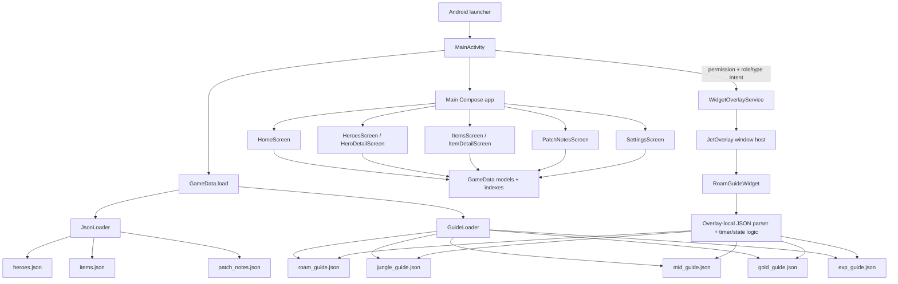
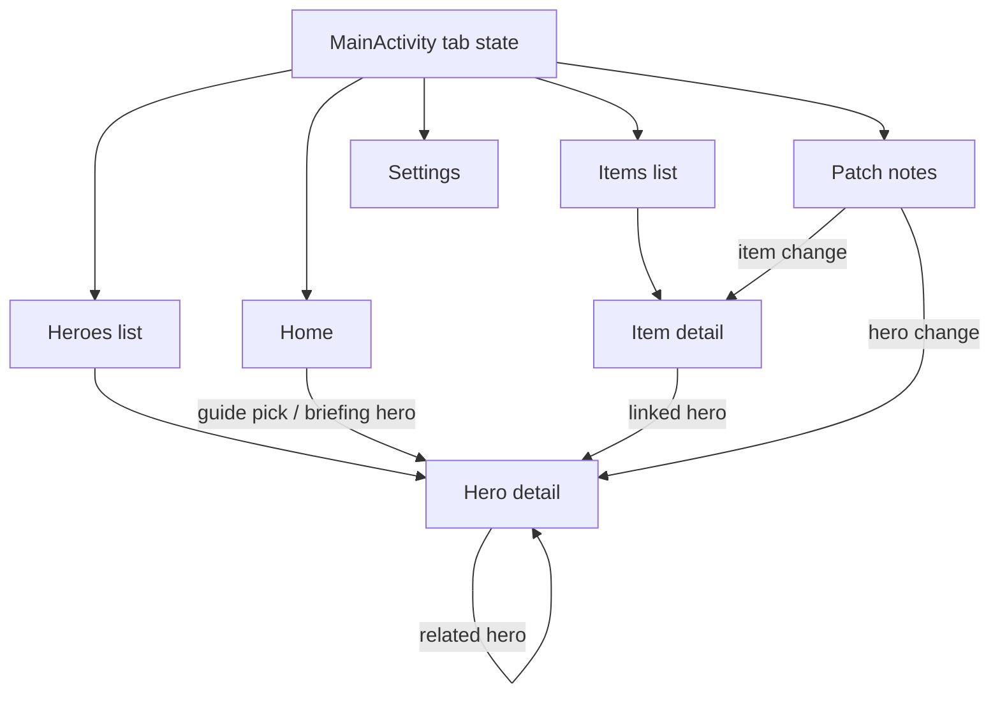
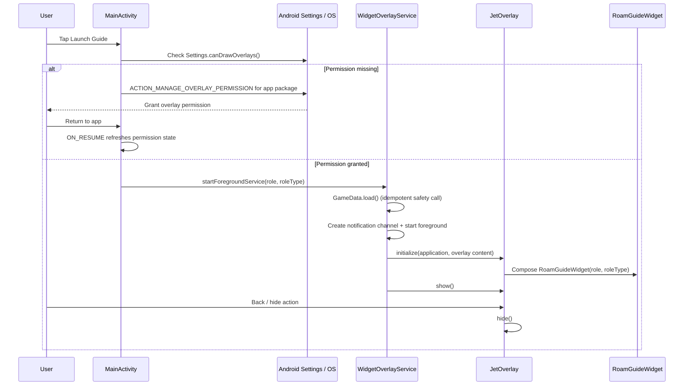

# MLBB Plus — Project Structure and Dependency Map

> **Scope:** This document describes the project as it exists in this repository snapshot (27 November 2026 / data patch 2.2.23; heroes data 2026-11-23, items data 2026-11-26, guides 2026-11-20). It is an implementation map, not a proposed architecture. Planned or absent components are called out explicitly.

## 1. System at a glance

MLBB Plus is a single-module Android application. Its launcher experience is built with Jetpack Compose. Bundled JSON files provide hero, item, patch-note, and five-lane guide content. A foreground service owns the separate always-on-top Compose overlay.



The screen-side guide parser and overlay-side guide parser are separate implementations. They read the same guide assets for different purposes: screen summaries versus the live, time-sensitive overlay plan.

## 2. Repository tree

```text
MLBB-Plus/
├── app/
│   ├── build.gradle.kts                      (+ downloadSherpaAar task)
│   ├── proguard-rules.pro
│   ├── libs/                                 (sherpa-onnx-1.13.8.aar, fetched on
│   │                                          demand and gitignored — never committed)
│   └── src/
│       ├── main/
│       │   ├── AndroidManifest.xml
│       │   ├── assets/
│       │   │   ├── heroes.json
│       │   │   ├── items.json
│       │   │   ├── patch_notes.json
│       │   │   ├── roam_guide.json
│       │   │   ├── jungle_guide.json
│       │   │   ├── mid_guide.json
│       │   │   ├── gold_guide.json
│       │   │   ├── exp_guide.json
│       │   │   ├── heroes/*.webp   (133 portraits)
│       │   │   └── items/*.webp    (99 portraits)
│       │   ├── java/com/mlbb/plus/
│       │   │   ├── tts/                      (Voice Guide — on-device spoken coach)
│       │   │   │   ├── TtsTextNormalizer.kt
│       │   │   │   ├── VoiceGuideSettings.kt
│       │   │   │   ├── VoiceEngine.kt
│       │   │   │   ├── SystemTtsVoiceEngine.kt
│       │   │   │   ├── VoiceModelDownloader.kt
│       │   │   │   ├── SherpaOnnxVoiceEngine.kt
│       │   │   │   └── VoiceGuideManager.kt  (+ VoiceGuideTransitions)
│       │   │   └── ui/
│       │   │       ├── MainActivity.kt
│       │   │       ├── WidgetOverlayService.kt
│       │   │       ├── components/UiKit.kt
│       │   │       ├── components/AppComponents.kt   (Material 3 redesign components)
│       │   │       ├── model/Models.kt
│       │   │       ├── model/Guides.kt
│       │   │       ├── model/KnowledgeBase.kt
│       │   │       ├── navigation/AppRoute.kt        (routes/tabs/deep-link spec)
│       │   │       ├── screens/
│       │   │       │   ├── AssetImage.kt
│       │   │       │   ├── HomeScreen.kt
│       │   │       │   ├── HeroesScreen.kt
│       │   │       │   ├── ItemsScreen.kt
│       │   │       │   ├── PatchNotesScreen.kt
│       │   │       │   └── SettingsScreen.kt
│       │   │       ├── theme/MLBBPlusTheme.kt
│       │   │       ├── theme/{Color,Type,Dimens}.kt  (Material 3 tokens)
│       │   │       ├── viewmodel/AppViewModel.kt     (StateFlow root state)
│       │   │       └── widgets/
│       │   │           ├── JetOverlay.kt
│       │   │           └── OverlayWidgets.kt
│       │   └── res/
│       │       ├── drawable/
│       │       ├── mipmap-anydpi-v26/
│       │       └── values/{colors.xml,strings.xml,dimens.xml,themes.xml}
│       └── test/java/com/mlbb/plus/tts/      (JVM unit tests — no device needed)
│           ├── TtsTextNormalizerTest.kt
│           └── VoiceGuideManagerTest.kt
├── docs/
│   ├── overview.md
│   ├── structure.md
│   ├── links.md
│   ├── refactoring-report.md
│   └── ux-redesign.md
├── scripts/
│   └── validate_assets.py
├── gradle/
│   ├── libs.versions.toml
│   └── wrapper/{gradle-wrapper.jar,gradle-wrapper.properties}
├── build.gradle.kts
├── settings.gradle.kts
├── gradle.properties
├── gradlew
├── gradlew.bat
├── TTS_IMPLEMENTATION.md                     (Voice Guide implementation record)
└── readme.md
```

`app/src/main/assets/heroes/` contains **133** bundled hero portraits and `app/src/main/assets/items/` contains **99** item portraits — one WebP per active item record (`items/{id}.webp`). Every declared local image path in both catalogues resolves; each item record additionally carries a remote `portrait` URL (Fandom) and Coil renders an initials fallback if an asset is unreadable. The resource directory contains launcher artwork and Android theme resources.

`scripts/validate_assets.py` was referenced by `readme.md` and `refactoring-report.md` but was absent from the repository; it was recreated on 2026-11-27 and extended with cross-file referential checks (patch-change ID ↔ roster name, version agreement, guide staleness warnings). It currently passes with one warning: `roam_guide.json` declares `meta.latest = true` while pinned to patch 2.2.16a.

## 3. Startup and navigation chain

### 3.1 Process and data startup

1. Android launches `MainActivity` from the `MAIN` / `LAUNCHER` intent filter in `AndroidManifest.xml`.
2. `MainActivity.onCreate()` calls `GameData.load(this)` before Compose content is installed.
3. `GameData.load()` is synchronized and idempotent (`isLoaded` prevents a second load).
4. `JsonLoader` parses `heroes.json`, `items.json`, and `patch_notes.json` into Kotlin model objects.
5. Hero core-build item names are reconciled with the parsed item catalogue by item ID.
6. `GuideLoader.loadAll()` parses the five guide JSON assets and links guide hero picks to `Hero.id` using case-insensitive hero-name matching.
7. `GameData` builds lookup/index maps for hero IDs, item IDs, guide references, and heroes grouped by core item.
8. `MLBBPlusApp` renders the main navigation and selected screen from this in-memory data.

`GameData` is the current in-process single source of truth for loaded catalogue data. There is no Room database, remote API client, repository interface, dependency-injection graph, or ViewModel layer in this snapshot. JSON is bundled locally, so core catalogue browsing does not require a network connection.

### 3.2 Main screen navigation

`MainActivity.kt` owns the root Compose navigation state:

- `Tab`: `HOME`, `HEROES`, `ITEMS`, `PATCH`, `SETTINGS`.
- Selected role and guide-type ID.
- Selected hero / item detail records and the return tab for hero details.
- Overlay permission and running state.
- The `auto_start_last_role` preference and saved last role/type (`SharedPreferences`).
- Back handling and saveable state for section roots.

On compact windows, the app uses a Material 3 `NavigationBar`. At widths of at least 600 dp, it uses `NavigationRail`. This is manual adaptive branching in `MainActivity`; the project does not currently use Navigation Compose or Navigation 3.



### 3.3 Screen-by-screen connections

| Screen / composable | Main inputs | Navigation or output |
|---|---|---|
| `HomeScreen` | Selected role/type, overlay permission/running state, `GameData` | Changes role/type; launches overlay; opens hero details from guide picks. Since 2026-11-27 it takes no `onOpenHeroes` / `onOpenItems` / `onOpenPatchNotes` callbacks — the Quick Actions row and CURRENT META banner that used them were removed |
| `HeroesScreen` | `GameData.heroes`, hero click callback | Opens `HeroDetailScreen` |
| `HeroDetailScreen` | Selected `Hero`, `GameData` ID maps and guide references | Overview / relationship content; related hero and item links |
| `ItemsScreen` | `GameData.items` | Opens `ItemDetailScreen` |
| `ItemDetailScreen` | Selected `Item`, item/hero indexes | Opens related items or heroes |
| `PatchNotesScreen` | `GameData.patchNotes`, hero/item lookup maps | Opens changed hero or item details |
| `SettingsScreen` | Overlay permission and auto-start preference, loaded data health | Requests Android overlay settings; changes auto-start preference; displays asset diagnostics |

`components/UiKit.kt` supplies shared visual controls (headers, labels, filter pills, search, sorting, tier badges, role colors, and icon definitions). Screen-specific layout and detail content remain in their respective screen files.

## 4. Data model and asset relationships

### 4.1 Hero catalogue: `heroes.json` → `Models.kt` → hero UI

- Root metadata describes version, update date, patch, season, source, patch changes, equipment changes, schema notes, and matchup dataset provenance.
- `heroes[]` contains hero identity, roles/lanes, tier/difficulty, rates, skills, emblems, core builds, matchup IDs, descriptions/lore, tags, images, and patch notes.
- `JsonLoader.loadHeroes()` converts each record into `Hero`, `HeroSkill`, `EmblemInfo`, `HeroStats`, and `BuildItem` values.
- Relationship arrays (`counters`, `counteredBy`, `synergies`, `bestPartners`) contain hero IDs; the UI resolves those IDs through `GameData.heroesById`.
- **Duplicate relationship fields:** each hero also carries `goodAgainst` / `badAgainst` / `goodWith` holding the same IDs, and the hero/item screens read *that* set (`goodAgainst`, `badAgainst`, `goodWith`) rather than `counters` / `counteredBy` / `synergies`. Both sets are currently identical for all 133 heroes (verified 2026-11-27: no self-links, no duplicates, every ID resolves). Collapsing them to one canonical pair is an open cleanup item — until then, any data edit must update both or the screens and the manifest will disagree.
- Per-hero provenance fields travel with the data: `matchupDataSource` / `matchupDataUpdated` (2026-11-21) / `matchupDataWindow` (past 1 day) / `matchupDataRank` (all ranks) / `counteredBySource` / `counteredByUpdated`, plus `tierSource` / `tierUpdated` (2026-11-23) and `loreSource`. Root-level `matchupData`, `matchupDataset`, and `tierSnapshot` blocks carry the dataset-wide method notes.
- `HeroImage()` in `AssetImage.kt` resolves JSON image paths / hero slugs to bundled portrait assets and renders a fallback when an image is unavailable.
- `HeroesScreen.kt` contains the searchable/filterable hero list, hero cards, hero detail tabs, overview, and hero relationship panels.

### 4.2 Item catalogue: `items.json` → `Models.kt` → item UI

- Root metadata describes the patch and item catalogue: `version 2.2.23-buildtree-2026-11-23`, `updated 2026-11-26`, `patchDate 2026-11-11`, `totalItems = totalActiveItems = 99`, `source` (Fandom Equipment page), `patchChanges` (10 notes), `notes`, `schema`, and `buildTreeMetadata` (`buildsInto` is the reverse of `buildPathIds`; links resolve by stable item ID).
- `items[]` contains item ID/name/slug, category, tier, price/sell price/price type/price note, `stats` (display strings) and `statsDetailed` (structured), passive/active descriptions, lore, `buildPath` / `buildPathIds` / `buildsInto`, relationship IDs (`goodAgainst`, `badAgainst`, `counters`, `counteredBy`, `goodAgainstHeroes` / `worksAgainstHeroes`, `badAgainstHeroes`, `goodWithHeroes` / `synergiesHeroes`), `recommendedFor`, `tags`, `status`, and image path (`image` = local WebP, `portrait` = remote URL, `fandomFile`).
- Categories in the current file: Attack 31, Magic 25, Defense 25, Movement 8, Roam 6, Jungle 3, Attack & Magic 1. Tiers: A 34, S 20, Tier 2 19, Tier 1 16, Blessing 7, Tier 3 3. Item IDs span 1001–9103; the original 41 records kept their IDs, stats and build paths so `heroes.json` core-build references still resolve (verified: 0 unlinked core items across all 133 heroes).
- `JsonLoader.loadItems()` creates `Item` and `ItemStat` values, defaulting `status` to `active` when absent.
- `ItemImage()` resolves the image path and provides a fallback.
- `GameData` builds `itemsById` and `heroesByCoreItem` indexes. Removed items stay in the model but are excluded from the active catalogue — with the 2026-11-26 cleanup, all 99 shipped records are `active`, so nothing is currently filtered out.
- `ItemsScreen.kt` renders item search/filter/sort, item detail, item relations, and links to heroes using the item.

### 4.3 Patch notes: `patch_notes.json` + hero manifest → `PatchData`

- `JsonLoader.loadPatchNotes()` reads the flat patch-note root or nested `originalServer` / `advancedServer` form. **The shipped file is flat**: it has no `originalServer`, `advancedServer`, or `nov01` blocks, so `PatchNotesScreen` renders the Current tab only and `PatchNotesFile.latest` comes from the root.
- It parses hero and item changes, highlights, battlefield/system changes, warnings, and metadata.
- It then reads `heroes.json.patchChanges` and merges those hero entries into the Original Server hero-change list **by hero ID** (`associateBy { heroId }`, so the manifest entry wins for a hero present in both files), then sorts by ID. `heroes.json.equipmentPatchChanges` is also copied into `PatchData.equipmentChanges`. With the current assets that yields **13** hero rows: the 10 in `patch_notes.json` plus Lukas, Karrie and Kagura from the manifest.
- **Version and date handling (fixed 2026-11-27):** `PatchData.version` is taken from `heroes.json.version`, which carries a data stamp (`2.2.23-tier-2026-11-23`). `PatchNotesFile.displayVersion` exposes that string for fallbacks, and `PatchNotesFile.shortVersion` exposes the bare patch number (`2.2.23`). **Always compare a guide's `meta.patch` against `shortVersion`** — comparing against the stamped version marks every guide as stale, including in the overlay. `PatchData.date` prefers `heroes.json.patchDate` (the live patch date, 2026-11-11) and falls back to `updated` (the data refresh date) then `patch_notes.json.date`.
- **Not merged:** `items.json.patchChanges` (10 entries, including the Nov 26 legacy-item removals) is never read by `loadPatchNotes()`; only the 2 `equipmentPatchChanges` strings from `heroes.json` reach the Patch screen. Surfacing the item manifest is an open decision (see `overview.md` §5 data-quality issues).
- `HomeScreen.kt` uses patch information for the home banner and patch movers; hero/item screens use patch badges/detail context; `PatchNotesScreen.kt` presents the full patch view.

### 4.4 Role guides: five JSON files → `GuideLoader` → Home and overlay

The guide files are:

| Asset | Role | Guide types | Timed steps | `meta.patch` | `meta.updated` |
|---|---|---:|---:|---|---|
| `roam_guide.json` | Roam | 6 | 66 | **2.2.16a** ⚠ stale | 2026-11-18 |
| `jungle_guide.json` | Jungle | 5 | 55 | 2.2.23 | 2026-11-20 |
| `mid_guide.json` | Mid | 5 | 55 | 2.2.23 | 2026-11-20 |
| `gold_guide.json` | Gold | 5 | 55 | 2.2.23 | 2026-11-20 |
| `exp_guide.json` | EXP | 5 | 55 | 2.2.23 | 2026-11-20 |

Totals: 26 types, 286 steps. Every guide declares `meta.latest = true`, including `roam_guide.json` — which is why staleness must be judged from `meta.patch` against `PatchNotesFile.shortVersion`, not from the `latest` flag. All five declare Season 42 objective timers (first Turtle 120s, respawn 120s, max 3, auto-convert to Lord at 480s; Lord fallback 480s, respawn 180s before 18:00 and 120s after, evolves at 1080s; Lithowanderer 45s; outer turret shield ends 300s).

Each asset uses a root structure with `meta`, role-specific auxiliary data (such as blessings, retribution types, or emblem guide), `roles[]`, `changelog`, `objectives`, and `battle_spells`. A guide type contains an ID/label/playstyle, hero picks, spells, emblem, core items, strengths/weaknesses, win/lose conditions, timed `steps[]`, and optional objective templates.

**Screen-side path:** `GuideLoader.loadAll(context, heroes)` reads each role asset. It parses metadata, mechanics, global rules, buffs/emblems, spell defaults, guide types, hero picks, and core item names into `GuideFile` / `GuideType` / `HeroPick` models. Hero picks are linked to hero IDs by name. `HomeScreen.kt` uses these to render role/type briefings and quick picks. `GameData` builds `guideRefsForHero()` and `guideRefsForItem()` indexes so hero/item detail screens can show guide usage.

**Overlay-side path:** `WidgetOverlayService` hosts `RoamGuideWidget` in `JetOverlay`. `OverlayWidgets.kt` has its own private parser (`loadGuide`, `parsePlan`, `parseStep`, timer parsing) because the overlay needs timed step and objective state. It selects `${role.lowercase()}_guide.json`, computes game-time/objective state, and renders the interactive guide. Despite the historical function name `RoamGuideWidget`, it receives the selected role and role type and is the shared overlay entry point for the five role assets.

### 4.5 Images and Android resources

- `app/src/main/assets/heroes/*.webp`: bundled hero portraits consumed by `HeroImage()`.
- `app/src/main/res/drawable/`: launcher foreground/background vector artwork.
- `app/src/main/res/mipmap-anydpi-v26/`: adaptive launcher icon definitions.
- `app/src/main/res/values/colors.xml`: Android resource color tokens.
- `strings.xml`: app and notification strings.
- `themes.xml`: platform window theme and system-bar defaults.
- `MLBBPlusTheme.kt`: Compose theme definitions. `AppUiTheme` / `AppUiColors` are for the main app; `MLBBPlusTheme` / `MLBBPlusColors` are used by the floating overlay. Keep these roles distinct when changing UI styling.

## 5. Overlay launch and lifecycle chain



`AndroidManifest.xml` declares `SYSTEM_ALERT_WINDOW`, `FOREGROUND_SERVICE`, `FOREGROUND_SERVICE_SPECIAL_USE`, `POST_NOTIFICATIONS`, and — for the Voice Guide model download only — `INTERNET` and `ACCESS_NETWORK_STATE`. The service is non-exported and declared with foreground type `specialUse` plus a subtype explanation. `WidgetOverlayService` creates an ongoing notification with an app-open intent and Stop action, updates the active role/type, initializes the overlay once per service instance, and hides/stops the overlay on destruction.

`JetOverlay.kt` is the low-level window host. It owns the overlay window, ComposeView attachment, and lifecycle / saved-state / ViewModel-store owners needed by Compose outside an Activity. `OverlayWidgets.kt` owns the visible guide, overlay-specific parsing, interaction state, game timer, objective timers, and enemy spell tracker UI.

### 5.1 Voice Guide chain (off by default)

`WidgetOverlayService` constructs one `VoiceGuideManager` and passes it into `RoamGuideWidget` as an optional parameter; the widget passes nothing back except calls. There is deliberately no second service, no DI and no shared ViewModel.

```text
timer advances / player taps Next
  → OverlayWidgets maps GuideStep → SpokenStep(key = "planId#index#startSeconds")
  → LaunchedEffect(key) registers the step, and calls onStepAdvanced() when the feature is on
  → VoiceGuideManager.shouldAutoSpeak() (VoiceGuideTransitions) decides: once per step, never on a
    recomposition or a 1 Hz clock tick
  → resolveEngine(): System preference → SystemTtsVoiceEngine; otherwise first installed model →
    SherpaOnnxVoiceEngine; on load failure → System (Auto) or an explained error (Neural)
  → TtsTextNormalizer condenses the step to the word budget and phrases the clock
  → audio focus GAIN_TRANSIENT_MAY_DUCK (game ducked, never muted) → speak
  → VoiceUiState flows back to VoiceControlRow (label/action from VoiceGuideTransitions) and to the
    notification via observeVoiceForNotification()
```

Guards that matter when touching this path: TalkBack on ⇒ the coach refuses to speak and shows a hint; 30 s idle ⇒ the engine is released (`IDLE_RELEASE_MS`); phone call / `AUDIOFOCUS_LOSS` ⇒ stop. `VoiceGuideSettings.revision` + `bump()` keeps the Settings-screen manager and the service manager in step — only **user-facing** setters may bump, or a manager would release its own engine mid-sentence or cancel its own download. Full detail: [`../TTS_IMPLEMENTATION.md`](../TTS_IMPLEMENTATION.md).

## 6. Kotlin file responsibilities

| File | Responsibility | Main dependencies / consumers |
|---|---|---|
| `MainActivity.kt` | Activity entry point, root navigation, settings/preferences, permission flow, service launch | `GameData`, all screens, `WidgetOverlayService`, `AppUiTheme` |
| `WidgetOverlayService.kt` | Foreground service lifecycle, notification (now with Play/Pause + Stop voice actions), active role/type, overlay initialization/show/hide; owns the `VoiceGuideManager` and pushes its state into the notification | `GameData`, `JetOverlay`, `RoamGuideWidget`, `MLBBPlusTheme`, `tts/VoiceGuideManager` |
| `components/UiKit.kt` | Shared app composables, icons, role/tier colors, search/filter/sort primitives | Main screens |
| `model/Models.kt` | Hero/item/patch models, JSON parsers, `JsonLoader`, `GameData` and cross-reference indexes | Activity, screens, settings diagnostics, overlay service |
| `model/Guides.kt` | Guide screen models, guide asset parser, hero/item guide reference models | `GameData`, Home and detail screens |
| `screens/HomeScreen.kt` | Home dashboard: role/type picker, guide briefing, collapsible lane-mechanics card, launch CTA | `GameData`, guide models, shared components, images |
| `screens/HeroesScreen.kt` | Hero catalogue, filters/search/sort, hero detail and relationship tabs | `Hero`, `GameData`, `HeroImage`, `ItemImage` |
| `screens/ItemsScreen.kt` | Item catalogue, filters/search/sort, item detail and related entities | `Item`, `GameData`, `ItemImage`, `HeroImage` |
| `screens/PatchNotesScreen.kt` | Patch note sections/cards and navigation to changed entities | `PatchData`, `GameData` |
| `screens/SettingsScreen.kt` | Overlay permission request UI, auto-start setting, data-file status/diagnostics, Knowledge Base reader, and the Voice Guide section (engine/voice/speed/auto-speak/announce-spells, model download, test line) | Activity callbacks, `GameData`, `KnowledgeBase`, `tts/*` |
| `screens/AssetImage.kt` | Coil asset model resolution, hero/item portrait rendering and fallbacks | Bundled image assets, `Hero`, `Item` |
| `theme/MLBBPlusTheme.kt` | Separate Compose color schemes / typography for app and overlay | Main app and overlay service |
| `widgets/JetOverlay.kt` | WindowManager overlay host and Compose lifecycle owners | `WidgetOverlayService`, Compose and lifecycle APIs |
| `widgets/OverlayWidgets.kt` | Shared role guide overlay UI, local JSON parser, timers and spell tracker; maps the current step to a `SpokenStep`, draws `VoiceControlRow`, and tints the line being read aloud | Role guide JSON, `GameData`, overlay theme, `tts/VoiceGuideManager` |
| `model/KnowledgeBase.kt` | In-app help library: 19 topics with details, quick-reference tables, common mistakes, app tips and related-topic links | Settings Knowledge Base reader |
| `tts/TtsTextNormalizer.kt` | Pure JVM: guide text → condensed spoken English (clock phrasing, abbreviation expansion, symbol cleanup, word-budget truncation) | `tts/VoiceGuideManager`, overlay widget, unit tests |
| `tts/VoiceGuideSettings.kt` | SharedPreferences for the feature plus a `revision` counter so the two manager instances stay in step | Settings screen, manager, overlay service |
| `tts/VoiceEngine.kt` | Engine contract (`prepare`/`speak`/`pause`/`resume`/`stop`/`setSpeechRate`/`release`, `supportsPause`) | Both engine implementations, manager |
| `tts/SystemTtsVoiceEngine.kt` | Android `TextToSpeech` adapter — the always-available fallback | Manager |
| `tts/VoiceModelDownloader.kt` | Model catalogue (URLs, sha256, sizes) and streaming `.tar.bz2` download → verify → extract into `filesDir/tts/` | Manager, Settings screen |
| `tts/SherpaOnnxVoiceEngine.kt` | sherpa-onnx Kokoro/Piper configuration and `AudioTrack` playback | Manager, sherpa-onnx AAR |
| `tts/VoiceGuideManager.kt` | State machine (`Phase`, `VoiceUiState`), speak/pause/resume/repeat/step APIs, audio focus, TalkBack, idle release, download orchestration; `object VoiceGuideTransitions` is the shared decision table | Overlay service, widget, Settings screen, unit tests |

## 7. Build, platform, and dependencies

- Gradle root project: `MLBB Assistant 2.0`; included module: `:app`.
- Android Gradle Plugin: `9.2.1`.
- Kotlin: `2.3.21`; Kotlin Compose compiler plugin is applied through the version catalog.
- Compile SDK: `37`; target SDK: `36`; minimum SDK: `29`.
- Java source/target compatibility: `17`.
- Compose BOM: `2026.06.00`.
- AndroidX Core KTX: `1.16.0`.
- Lifecycle: `2.11.0`.
- Activity Compose: `1.13.0`.
- Coil Compose: `3.0.4`.
- SavedState: `1.2.1`.
- Other UI: Compose UI, Foundation, Material 3, tooling preview.
- Repositories: Google and Maven Central. **No JitPack** — sherpa-onnx has no builds there.
- TTS: `sherpa-onnx-1.13.8.aar`, vendored as `implementation(files("libs/sherpa-onnx-1.13.8.aar"))` and fetched on demand by the `downloadSherpaAar` task (sha256-verified, `.part` → rename, `onlyIf { !exists() }`, wired into `preBuild` and every `*compile*Kotlin*` task). Pinned to 1.13.8 deliberately: on 2.0.x Piper fails to initialise and Kokoro needs an extra lexicon file.
- `org.apache.commons:commons-compress:1.25.0` — `.tar.bz2` extraction (1.26+ would pull commons-io and commons-lang3).
- `junit:4.13.2` (`testImplementation`) with `testOptions { unitTests.isReturnDefaultValues = true }` for the 36 JVM tests in `app/src/test/java/com/mlbb/plus/tts/`.
- Permissions added for the model download only: `INTERNET`, `ACCESS_NETWORK_STATE` (unmetered check before offering a 103 MB file). No model binary ships in the APK; models land in `filesDir/tts/`.
- The AAR carries `arm64-v8a`, `armeabi-v7a`, `x86` and `x86_64` native libs; a commented-out `splits { abi { } }` block is in `app/build.gradle.kts` for when ABI filtering is verified.
- Release build enables code minification and resource shrinking; debug disables both.
- Gradle wrapper distribution: Gradle `9.6.1`.

The versions above are read from `gradle/libs.versions.toml`, `app/build.gradle.kts`, and `gradle/wrapper/gradle-wrapper.properties`; they are not recommendations to upgrade blindly.

## 8. Change-impact guide

| If you change… | Also inspect / validate… |
|---|---|
| Hero JSON fields | `Hero`, `JsonLoader.loadHeroes`, hero list/detail UI, `heroes.json` relationship fields |
| Hero IDs or names | Item/guide references, guide name-to-ID linking, relationship IDs, patch changes |
| Item JSON fields | `Item`, `JsonLoader.loadItems`, item detail UI, hero core-build resolution |
| Guide JSON schema | Both `GuideLoader` and the private parser in `OverlayWidgets.kt`; Home and overlay must remain compatible |
| Objective or spell timing | Guide `meta`, `battle_spells`, overlay timer parsing/computation, in-game behavior checks |
| Patch schema | `JsonLoader.loadPatchNotes`, hero manifest merge, Home banner, Patch screen, entity badges |
| Main app theme | `AppUiTheme` / `AppUiColors`, app screens, system bars |
| Overlay appearance | `MLBBPlusTheme` / `MLBBPlusColors`, `OverlayWidgets.kt` (overlay-only) |
| Overlay lifecycle / permission | Manifest, `MainActivity`, `WidgetOverlayService`, `JetOverlay`, Android version behavior |
| Gradle dependency/version | Version catalog, app plugin configuration, wrapper compatibility, clean debug and release builds |
| Guide step text fields (`instruction`, `description`, `callout`, `phase`, `compact`, `dont`, `objective_*`) | `OverlayWidgets.toSpoken()` fallback chain, `TtsTextNormalizer` budgets and abbreviation table, `TtsTextNormalizerTest`, and a re-run over all 286 real steps |
| Voice Guide settings or pref keys | `VoiceGuideSettings` (including which setters call `bump()`), both manager instances, `SettingsScreen.VoiceGuideSection`, `VoiceGuideManagerTest` |
| sherpa-onnx version or a voice model | `downloadSherpaAar` sha256 + `VoiceModelDownloader.MODELS` URLs/checksums/sizes, `SherpaOnnxVoiceEngine` config and thread counts, the sid ↔ voice-name mapping, and the 1.13.8 pin rationale in `TTS_IMPLEMENTATION.md` §2 |
| `VoiceGuideTransitions` decision table | Manager `compose()`/auto-speak gate, `VoiceControlRow` label + click dispatch, notification Play/Pause label, `VoiceGuideManagerTest` |

## 9. Current architectural boundaries and known maintenance risks

1. **No repository abstraction yet.** `GameData` is a process-wide singleton that loads bundled assets directly. This is adequate for the current offline/static data model but will need a repository/data-source boundary for remote refresh, caching, or tests.
2. **Two guide parsers.** `GuideLoader` and `OverlayWidgets.kt` parse the same guide files independently. Schema changes must be checked against both; a future shared parser/model layer would reduce drift.
3. **Root navigation is hand-managed.** Navigation state lives in `MainActivity` rather than Navigation Compose / Navigation 3. Preserve Back and cross-screen return behavior when modifying it.
4. **Preferences use SharedPreferences directly.** The current saved values are last role, last guide type, and auto-start-last-role. DataStore would be a reasonable future migration if settings grow.
5. **Bundled content is static until the app is updated.** There is no in-app data downloader or background content refresh in this snapshot.
6. **Tests are not present in this repository snapshot.** Add parser tests, schema/ID integrity tests, and service/permission behavior tests before expanding the data/update pipeline.
7. **Build verification is environment-dependent.** A full build requires the configured Android SDK and successful dependency / Gradle distribution resolution.

## 10. Documentation cross-links

- Product mission and roadmap: [overview.md](overview.md)
- External references and sources: [links.md](links.md)
- Matchup data methodology: [links.md](links.md#3-mlbb-game-data-and-matchup-references)
- Kotlin review and UX/UI decisions: [refactoring-report.md](refactoring-report.md)


## 11. UX changes and implementation boundaries

The refactor improves the catalogue experience while preserving the floating guide's original in-match purpose.

Implemented in this pass:
- Hero and item grids use a fixed five-column grid. **Correction (2026-11-27):** an earlier revision of this section said "adaptive columns instead of seven fixed columns"; the shipped code uses `GridCells.Fixed(5)` in both `HeroesScreen.kt` and `ItemsScreen.kt`, with a comment recording that `GridCells.Adaptive` produced three ~102dp columns on a phone. An adaptive grid is proposed in [ux-redesign.md](ux-redesign.md), not implemented.
- Search, category/role/tier filters, and sort selections use saveable state.
- Hero and item sorting controls are visible and connected to their existing sort state.
- Removed item entries remain available in the data model but are excluded from the active item catalogue.
- Item detail relationship sections now use the JSON model's actual field names and semantics.
- Item portraits exist for every item record and have a runtime fallback through Coil.
- The overlay service validates role and playstyle IDs when starting or restoring the widget.

Implemented in the 2026-11-27 redesign/data-sync pass (details in [ux-redesign.md](ux-redesign.md) and `overview.md` §14):
- `HeroDetailScreen` and `ItemDetailScreen` now render a visible back control (`DetailBackBar`); both previously accepted an `onBack` callback and never used it.
- Predictive back enabled (`android:enableOnBackInvokedCallback="true"`).
- New Material 3 token files (`theme/Color.kt`, `theme/Type.kt`, `theme/Dimens.kt`), reusable components (`components/AppComponents.kt`), route/tab definitions (`navigation/AppRoute.kt`), and a lightweight `viewmodel/AppViewModel.kt`. `AppUiTheme` gained `darkTheme` / `dynamicColor` parameters but still defaults to dark, because screens read `AppUiColors.*` directly.
- `PatchNotesFile.shortVersion` added and used wherever a bare patch number is compared or displayed (Patch screen, overlay patch label, Settings diagnostics, Home/Heroes/Items headers), replacing three duplicated `substringBefore("-")` expressions.
- Settings guide-staleness now keys off the patch number rather than the self-declared `meta.latest` flag.

Home simplification (2026-11-27, second pass):
- Removed from `HomeScreen`: the CURRENT META patch banner, QUICK START card, PATCH MOVERS row, QUICK ACTIONS row and TOP META HEROES row, plus the private composables that rendered them (`PatchBanner`, `QuickStartCard`, `QuickStartStep`, `MoverCard`, `QuickActionCard`, `MetaHeroCard` — 143 lines) and the now-unused `onOpenHeroes` / `onOpenItems` / `onOpenPatchNotes` parameters. `MainActivity`'s call site was updated to match.
- `MechanicsCard` is now a single collapsible card, **collapsed by default**, with the section title inside its 56dp header row, a chevron that rotates on expand, a saved expand/collapse state keyed on the role, and `stateDescription` semantics for TalkBack.
- Quick-start guidance moved to `KnowledgeBase.kt` as the new first entry (`id = "quick-start"`, category "Getting Started"), so the Knowledge Base reader now opens on it. The `meta` entry's description of Home was updated to stop referencing the removed sections.
- `GameData.topMetaHeroes` (`Models.kt`) is now unreferenced — retained as a data-layer helper, flagged as dead code.

The overlay continues to provide a role-aware guide, match timer, objective timing, and enemy battle-spell cooldown tracking. It remains draggable, dismissible, and touch-pass-through outside its window. The refactor does not replace it with a generic floating button or add distracting animation.

## 12. Matchup data validation record

The matchup source, snapshot date, rank/timeframe, fallback method, and interpretation caveats are documented in [links.md](links.md#3-mlbb-game-data-and-matchup-references). The repository does not ship a separate machine-readable matchup audit artifact.

When hero IDs, names, or matchup arrays change, validate that:
1. Every relationship ID resolves through `GameData.heroesById`.
2. No hero links to itself and no duplicate relationship IDs occur.
3. The direction of `counters` and `counteredBy` remains consistent with the documented definitions.
4. Source date, patch, rank scope, timeframe, fallback provenance, and caveats are updated together.

`scripts/validate_assets.py` (recreated and extended 2026-11-27) checks: JSON syntax for all eight assets; declared hero/item totals against actual counts; duplicate hero/item IDs; every declared local portrait path; matchup arrays for self-links, duplicates, and unresolved IDs; guide hero picks resolving by name; **patch-change IDs cross-checked against the roster name** in both `patch_notes.json` and `heroes.json.patchChanges` (this is what catches a Masha-pointing-at-Baxia style bug); cross-file agreement on the bare patch number; and a warning when a guide declares `meta.latest = true` while pinned to an older patch. Current result: **pass, 1 warning** (`roam_guide.json` at 2.2.16a).

It does **not** prove the accuracy or predictive power of matchup data, does not compile Kotlin, and does not exercise the overlay; those require a data audit, a Gradle build, and device testing respectively.

